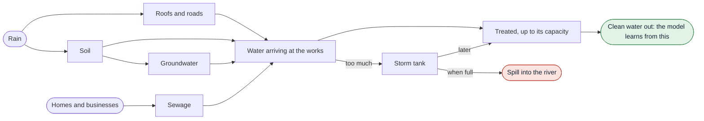

# wAIsted

Predicting when sewage works around Oxford spill into rivers, and finding the ones that spill when they shouldn't.

🥈 Runner-up for HRT's Best Use of Data for Predictions and Decision Making prize at OxHack 2026.

Live site: <https://waisted.pages.dev>  
Devpost: <https://devpost.com/software/waisted-m0ylrd>

[](https://waisted.pages.dev)

## The problem

The UK government and water companies are investing over £100 billion in water infrastructure, yet sewage was released into England's rivers nearly 300,000 times in 2025. When heavy rain fills the sewers faster than a treatment works can cope, the extra is released untreated into rivers and streams.

This is only allowed once a works is already treating as much as its permit requires. But spill monitors only record that a spill happened, not whether it was necessary.

## What it does

We built a model of 52 sewage works around Oxford. Hour by hour, it tracks the water arriving from homes, rain and groundwater, how much each works can treat, and how much its storm tank can hold. It learns only from how much water each works treated, never from its spill records, so it can judge fairly when a works should have spilled.

With it you can:

- see which works are likely to spill over the next 7 days
- check whether each stretch of river is safe to swim in and safe for fish
- change the rain, a storm tank's size or a works' capacity, and see how the spills change
- find works that spill when the model says they shouldn't, as a list for inspectors

## How a works spills



## Results

Tested on a year of data the model never saw, October 2025 to October 2026:

- It called 92% of days correctly, spill or no spill, without ever being shown a spill record.
- In the storm of 23 October 2026 it expected 16 spills, and 16 happened.
- Its learned numbers match real-world figures, such as each person producing about 163 litres of sewage a day.
- It flagged 7 works as strong leads for inspection. The clearest, Shabbington, treated about a fifth of its permitted flow on 52 of the 54 days it spent spilling all day.

The model only has daily totals of treated water, so it misses short peaks during storms and underestimates how long spills last. A flagged works is a reason to look, not proof of wrongdoing.

## Data

All open data: Thames Water (spills and treated water), the Environment Agency (rain and river flow), Open-Meteo (evaporation and weather forecasts), the Oxford Rivers Improvement Campaign (permitted flows) and Ordnance Survey (rivers).

## Repository

```
web/        the website
scripts/    downloads the data, runs the models and builds the website's data
docs/       how everything works, in detail
data/       the downloaded data (not stored in git)
```

## Rebuild

Only needed to change the model or update the data. From the repo root, in about 30 minutes:

```bash
python3 -m venv .venv && .venv/bin/pip install -r requirements.txt && source .venv/bin/activate
python scripts/fetch.py alerts && python scripts/fetch.py events && python scripts/fetch.py status && python scripts/fetch.py gauges
for s in scripts/model/0*.py scripts/model/10_watchlist.py; do python $s; done
for s in rivers outfalls physics quality stats; do python scripts/web/$s.py; done
```

A few files are downloaded by hand first; [docs/data.md](docs/data.md) lists them. To update the forecast, set `DATA_END` in `scripts/model/common.py` to the end of yesterday and run it all again.

## More detail

- [How the model works and how well it does](docs/model.md)
- [The works flagged for inspection](docs/watchlist.md)
- [How E. coli and ammonia are estimated](docs/water-quality.md)
- [Every dataset and how it was cleaned](docs/data.md)
- [Oxford background, similar work and sources](docs/background.md)
