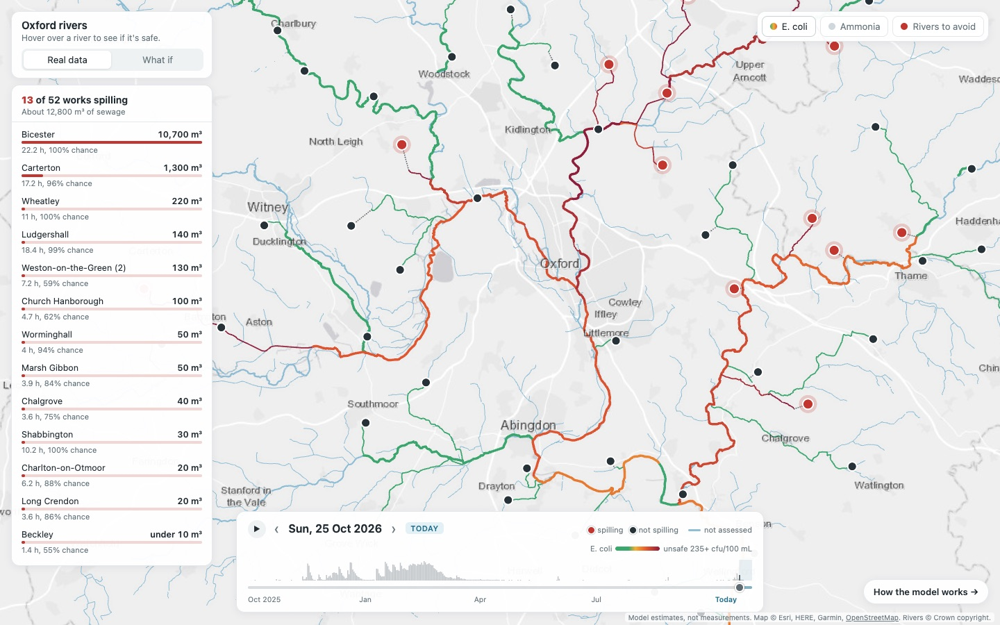
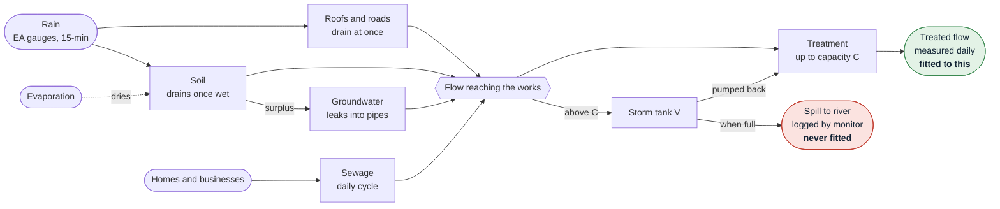
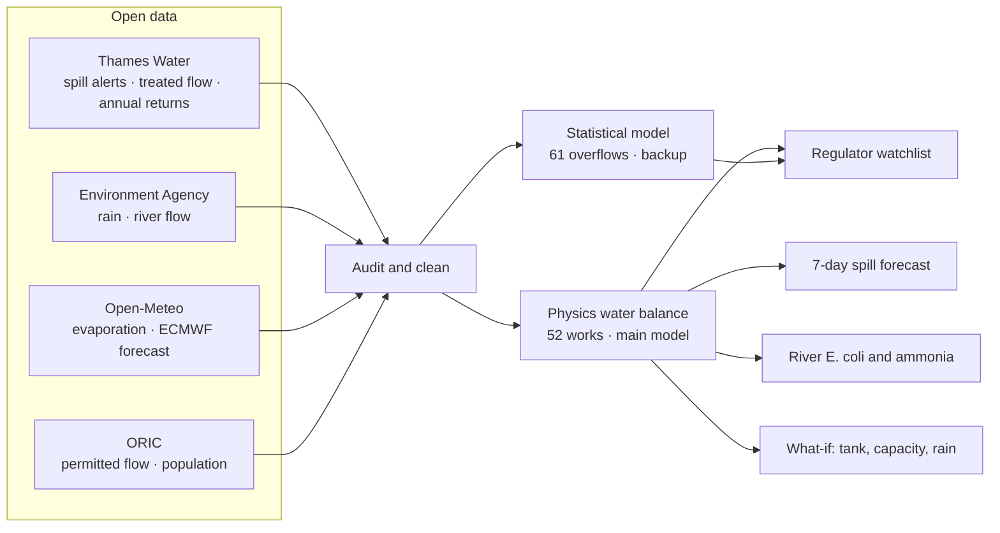

# Spillcast

**Which sewage works spill when they shouldn't, and where would the money stop it?**

🥈 Runner-up, HRT prize for *Best Use of Data for Predictions and Decision Making*, OxHack 2026.

**Live site: <https://waisted.pages.dev>**

[](https://waisted.pages.dev)

## The problem

The UK government and water companies are investing over **£100 billion** in water infrastructure from 2025 to 2030, yet storm overflows in England discharged sewage nearly **300,000 times in 2025**. In a storm, rain floods into the sewers. When more water reaches a treatment works than it can treat, the excess is dumped untreated into rivers and streams.

That is allowed only in a genuine storm, once the works is treating its full permitted flow and its storm tank is full. But spill monitors record only *that* a works spilled, not *whether it had to*. So a regulator can't tell an unavoidable spill from a works that is failing, and nobody can say where the next pound cuts the most sewage.

## What Spillcast does

Spillcast models every Thames Water sewage works within 25 km of Oxford as plumbing, hour by hour: water in from homes, rain and groundwater; treated up to capacity; the excess held in a storm tank; and only what the tank can't hold spills. The model is fitted only to the water each works *treated*, and **never sees a spill record**. That makes it an independent judge of when a works should spill.

- **Inspect:** a watchlist of works that spill while treating well below their permit, or in weather that doesn't explain it.
- **Forecast:** the chance each works spills over the next 7 days, from the 51-member ECMWF ensemble rain forecast.
- **Protect:** E. coli and ammonia every 100 m of river, so you can see whether a stretch is safe to swim in and safe for fish, past and forecast.
- **Invest:** rerun any day with more rain, a bigger storm tank or more treatment capacity, and see how many spills it removes and which rivers come clean.

## How a works spills



Each fitted number is physical and can be checked: litres per person per day, hectares of land draining to the sewer, days for groundwater to drain. The storm tank comes from published sources where we found them, and from the 2-hour design rule elsewhere. Two hundred runs with realistic inflow errors turn one simulation into a **chance of spilling** each day. Full equations: [docs/model.md](docs/model.md).

## From data to decisions



The statistical backup is a small rain-and-wet-ground model fitted to spill records. It covers the 9 overflows the water balance can't run at, which have no usable treated-flow data. It also has to agree before a spill counts as "unexplained by the weather", which guards against the physics model's known undercount.

## Results

Scored on a year neither model was trained on (Oct 2025 – Oct 2026), at 52 works.

| | |
| --- | --- |
| **Ranks spill days without seeing one** | Median AUC 0.96 per works, against 0.98 for a model fitted to the spill records. Days called right: 92%, against 87% for always guessing "no spill" |
| **Live storm, 23 Oct 2026** | 16.2 spills expected, 16 happened; 10 of them flagged at 50%+ |
| **The physics means what it says** | Sewage 163 L per person per day; capacity within 7% of the published permitted flow; peak groundwater leakage 1.07× Thames Water's own allowance; the 2-hour tank rule within 6–18% of the real tanks |
| **Watchlist** | 7 strong and 14 moderate leads among 53 works; 4 of the 7 strong leads had no Thames Water investigation in its 2025 return |

**Clearest lead: Shabbington.** It treated a median 22% of its permitted flow on 52 of its 54 all-day spill days. Every lead comes with dates and the operator records that would settle it: [docs/watchlist.md](docs/watchlist.md).

**Honest limits.** Treated flow is published only as daily totals and stops at capacity. The model therefore can't see how far a storm overshoots, and it undercounts spill-hours by about 27%. Spill volumes rank works but can't be checked against measurements. A lead is a reason to look, not proof of a breach.

## Repository

```
web/                  the live site (https://waisted.pages.dev): index.html (river map, forecast, what-if), model.html (method and backtest), data/
scripts/fetch.py      downloads spill alerts and EA rain and river-flow gauges into data/raw/
scripts/model/        01–10 in order: sites, audit, clean data, statistical model, water balance, forecast, watchlist
                      wb.py the water balance · common.py shared code · tanks.csv sourced storm-tank volumes
scripts/web/          builds web/data/*.json from the model outputs
docs/                 model · watchlist · water quality · data · background and sources
data/                 raw and cleaned data (git-ignored, ~500 MB)
```

## Rebuild

Only needed to change the models or refresh the data. Run from the repo root (about 30 minutes, mostly the alert download):

```bash
python3 -m venv .venv && .venv/bin/pip install -r requirements.txt && source .venv/bin/activate

python scripts/fetch.py alerts && python scripts/fetch.py events && python scripts/fetch.py status && python scripts/fetch.py gauges
# by hand into data/raw/ (links in docs/data.md): Thames Water treated volumes (tdv/) and annual returns
# (annual_returns/), the ORIC capacity sheet (oric_fft.xlsx), OS Open Rivers (os_open_rivers/)

for s in scripts/model/0*.py scripts/model/10_watchlist.py; do python $s; done
for s in rivers outfalls physics quality stats; do python scripts/web/$s.py; done
```

`09_forecast.py` fetches the live ECMWF ensemble. To move the forecast on, set `DATA_END` in `scripts/model/common.py` to the last full hour of yesterday (UTC), then rerun everything except `01_sites.py` and `rivers.py`.

## Docs

| | |
| --- | --- |
| [model.md](docs/model.md) | The physics water balance and the statistical backup: equations, fitting, checks, scores, forecast, limits |
| [watchlist.md](docs/watchlist.md) | The two tests, the current leads, and what to request from the operator |
| [water-quality.md](docs/water-quality.md) | E. coli and ammonia every 100 m of river: method, parameters and their sources |
| [data.md](docs/data.md) | Every dataset, what the audit found, and every file the pipeline writes |
| [background.md](docs/background.md) | Oxford context, prior work, and every source |
