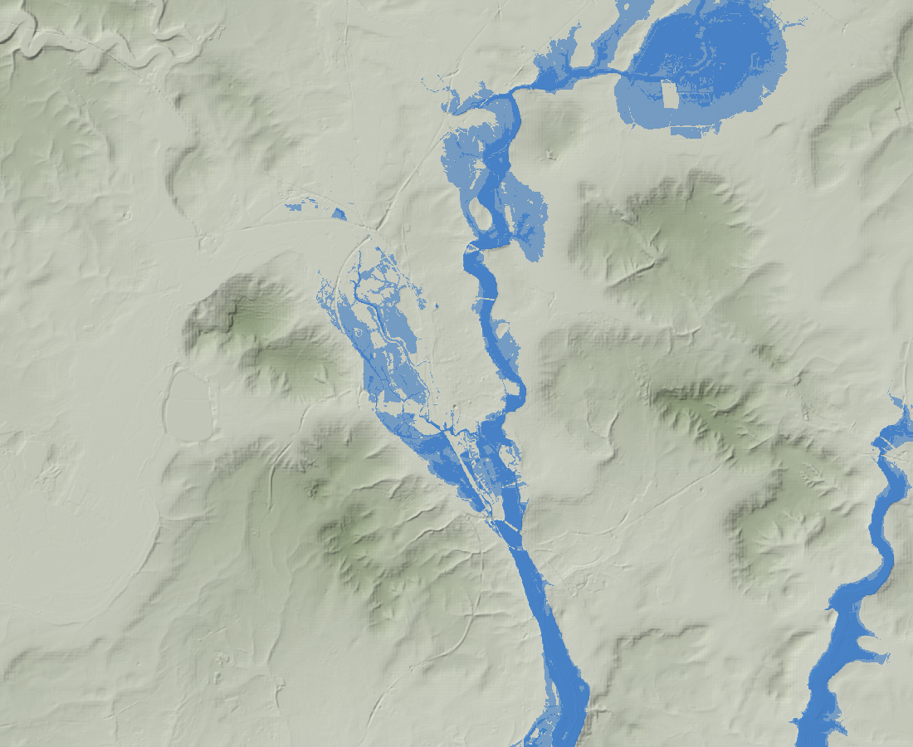

# 06 · Website and visuals

**Verdict:** rebuild flat-first.

- **Lead with:** a swim decision card, then an **overflow × day matrix heatmap**, then a 2D map on real Oxford hillshade with rivers coloured downstream of each overflow.
- **3D** is for one storytelling view only.
- **Pipes** can't be shown; show the catchment, pumping stations, downstream traces and a schematic.

## Real terrain and water levels

*EA LIDAR Composite DTM 2022 at 20 m, E 440–462 km × N 198–216 km. Blue = ground within 1 m of a rough, linearly interpolated Thames level (illustrative, not a flood model). You can see the Cherwell and Thames floodplains, Port Meadow, Otmoor's basin (top right), and Wytham, Headington, Shotover and Boars Hill. Regenerate with `scripts/fetch_data.py dtm --res 20`, then `scripts/terrain/hillshade.py`.*

**Sources:** see [01 §Geography](01-data-sources.md#geography). In short:

- **Terrain:** AWS Terrarium tiles (EA LIDAR 2 m in the UK) on the website, or the EA WCS for precise heights.
- **Flood extent:** EA Flood Zones 2/3 OGC API.
- **Water levels:** gauge datums + readings, converted to mAOD.
- **Buildings:** DSM − DTM, or OpenFreeMap.

**Ways to show water so people get it:**

1. **Rivers coloured by today's level** against each gauge's typical range, with a small staff-gauge glyph per gauge (low / typical / high / record).
2. **Floodplain at today's level:** ground below the nearby river level plus a margin, connected to the river, shaded blue.
   - A "+0.5 m / +1 m" toggle shows how far high water spreads.
   - Label it illustrative, and overlay EA Flood Zone 3 as the official extent.
3. **"Sewers sitting in groundwater":** where depth to the water table (DTM minus an interpolated water surface) is under about 2.5 m.
   - The 2.5 m threshold is an assumption; state it on screen.
   - This layer explains infiltration spills.

**Rendering:**

- MapLibre GL JS 5.x, with a `raster-dem` source driving `terrain`, `hillshade` and the [`color-relief`](https://maplibre.org/maplibre-gl-js/docs/examples/add-a-color-relief-layer/) layer (the official example pins 5.16.0).
- `fill-extrusion` for buildings; deck.gl via `MapboxOverlay` for the data layers.
- Use 1.5–2× vertical exaggeration; Oxford's relief is only about 120 m.
- **Inside a claude.ai artifact, external tiles are blocked.** Ship the DTM as a published heightmap file there; on the real site, use the tiles.

## Heatmap or other forms?

| Form | Verdict | Why |
| --- | --- | --- |
| 3D extruded columns | **Cut** | Slower to read than flat colour; occlusion and foreshortening; users rotate the map hunting for a view ([Yang et al. 2020 review](https://ar5iv.arxiv.org/html/2006.14120)). Tall shapes get read as size ([Padilla et al. 2017](https://pmc.ncbi.nlm.nih.gov/articles/PMC5626802)). |
| Kernel-density heatmap on the map | **Cut** | Overlapping kernels make the space *between* overflows look worse than the overflows themselves; the bandwidth is arbitrary ([explainer](https://landscapearchaeology.org/?p=551)). It invents spills in fields. |
| **Overflow × day matrix heatmap** | **Lead chart** | Rows upstream → downstream; 14 days past + 3–7 ahead; cells = chance in 5 bins; dots = actual spills. Forecast and outcome on one grid, read like [warming stripes](https://en.wikipedia.org/wiki/Warming_stripes). Keep a legend. |
| Flat map, rivers coloured downstream | Main map | The sewagemap.co.uk idea; overflow dots in the same bins; clicking one syncs the matrix row |
| Icon array ("4 in 10") | Decision card | Frequency framing beats a bare % and stating the no-event chance helps ([Peachey, Morss et al. 2013](https://atmos.washington.edu/~robwood/papers/weather/prob-revised.pdf)). Quantile dotplots gave better decisions than text or density ([Kay 2016](https://idl.uw.edu/papers/when-ish-is-my-bus), [Fernandes 2018](https://idl.uw.edu/papers/uncertainty-bus)). |
| Tiers (OK / caution / avoid) | Always with the number | Tiers work ([Met Office warning matrix](https://weather.metoffice.gov.uk/guides/warnings)), but hard cut-offs cause cliff effects |
| Reliability diagram | Track-record section | With bin counts and a sharpness histogram |

**What UK sites already do:**

- **[Top of the Poops](https://www.top-of-the-poops.org/explore)**: dots sized by hours over animated rain. Already labels "more sewage than the rain explains".
- **Thames Water EDM map**: red/green pins, red for 48 h after a spill. It warns the data "indicates" rather than "confirms" a spill.
- **SAS Safer Seas & Rivers**: status list and alerts first, map separate "so that check stays fast". About 208k users.
- **EA bathing waters**: binary, in-season only. Port Meadow gets no forecast now. **That's the gap.**
- **Abroad:** the Charles River [flagging programme](https://www.crwa.org/flagging-program) turns a rain model into blue/red flags (red automatic for 48 h below an overflow). Swim Guide greys out data older than 7 days. Copy both ideas.

**Wording a probability:** "About **4 in 10** days like today have had sewage reach Port Meadow; 6 in 10 haven't." Follow with a 10-icon row, the main reason ("groundwater is high") and one action ("avoid putting your head under for 48 h").

**Modelling caveat for the "why" chart:** the stacked flow chart is valid for the bucket model, where the parts add in ML/day. For LightGBM, contributions add in log-odds, so show counterfactuals instead ("with dry ground: 9%; with today's groundwater: 38%").

## Pipes and sewage flows

| What | Source | Use it? |
| --- | --- | --- |
| Sewer pipes and manholes | Not published by Thames Water. NUAR is restricted to asset owners and contractors until at least 2028. Stream has no pipe data for any company. | **No** |
| Area draining to Oxford STW | [wastewater-catchment-areas](https://github.com/tillahoffmann/wastewater-catchment-areas) (MIT code; EIR-sourced data, © Thames Water) | Yes, labelled indicative and credited |
| Works and pumping stations | OSM Overpass (24 Oct): 14 wastewater plants, 17 pumping stations (about 12 named Thames Water SPS), 0 sewage pipelines | Yes, as markers |
| Live downstream traces | sewagemap GeoJSON (POOPy D8 routing), CORS open | Yes. Cache it and credit Alex Lipp / sewagemap. |
| Rivers for animation | OS Open Rivers (flow-direction digitised) | Yes |

**Do not use** a county-council map server that appears to expose Thames Water's internal sewer records with no licence. It's deliberately not linked here; consider telling the council.

**Ways to show flow:**

1. **Downstream trace for each overflow, coloured by the forecast.**
   - Walk OS Open Rivers links 10–15 km downstream in Python.
   - Optionally animate particles with deck.gl `TripsLayer`, timed by distance ÷ an assumed speed.
   - The trace also shows when the risk is *not* at your spot: Oxford STW is downstream of Port Meadow.
2. **"How a spill happens" schematic**, driven by the bucket model: catchment → pumping stations → works → full treatment (up to about 3 × DWF) → storm tank → overflow. Scroll steps suit this.
3. **Sankey for one day at Oxford STW:** sewage, groundwater and rain in; treated, stored and spilled out. Build it from TDV plus the model, or label it illustrative.

## Recommended page (top to bottom)

1. **Swim at Port Meadow today?** Tier word + number ("Avoid · about 4 in 10"), a 10-icon row, the main reason chip, one action, last-updated time, grey when stale.
2. **Outlook matrix:** overflows × days (14 past + 3 ahead), cells = chance in 5 bins, dots = actual spills.
3. **Flat map on real hillshade:** rivers coloured downstream, dots in the same bins, gauge glyphs. Toggles: groundwater zone, flood zone 3, STW catchment, live downstream trace.
4. **Why it spills:** Oxford STW flow stack vs capacity; small multiples of rain, Cherwell level and chance; duration and volume estimates with ranges.
5. **How a spill happens:** scroll story with the pipe schematic. The only place for 3D terrain (the water table rising under the city).
6. **What to do:**
   - (a) Storm tanks or sealing: £ sliders → spill-hours avoided per year, with before/after dotplots.
   - (b) Spills the weather can't explain, ranked by surprise.
7. **Track record (for the judges):** reliability diagram with bin counts, Brier skill vs climatology and persistence, sharpness histogram, wet / dry / this week.

Footer: sources and licences, method notes, data snapshot time, and a live / frozen toggle.

**Bins:** 5 sequential steps of one hue: < 5%, 5–20%, 20–40%, 40–70%, > 70%. Reserve red/amber/green for the swim decision, always paired with an icon and a word.

## Build stack

| Piece | Choice |
| --- | --- |
| Front end | Vite + TypeScript (or React) |
| Map | MapLibre GL JS 5.x + deck.gl 9 (`MapboxOverlay`) |
| Basemap | OpenFreeMap (no key) |
| Terrain | AWS Terrarium tiles |
| Charts | Observable Plot or hand-built SVG |
| Data | Python writes `public/data/*.json` and `*.geojson` |
| Refresh | **GitHub Actions cron every 30–60 min.** Required, because the Thames Water API sends no CORS header. The EA APIs, tiles and OpenFreeMap all return `Access-Control-Allow-Origin: *`. |
| Hosting | GitHub Pages, Cloudflare Pages or Vercel |

**Demo safety:** commit a frozen data snapshot and default to it, with a live toggle.

**Footer credits:** © Environment Agency; © OpenStreetMap contributors; Contains OS data © Crown copyright; Thames Water open data terms; sewagemap/POOPy.

## Prototype status

`prototype/` holds the dummy-data UI built on 24 Oct (deck.gl 3D columns, decomposition, reliability, swim flag, investment curves, anomalies). Keep the decomposition, reliability, investment and anomaly components. Replace the 3D map with the layout above.
