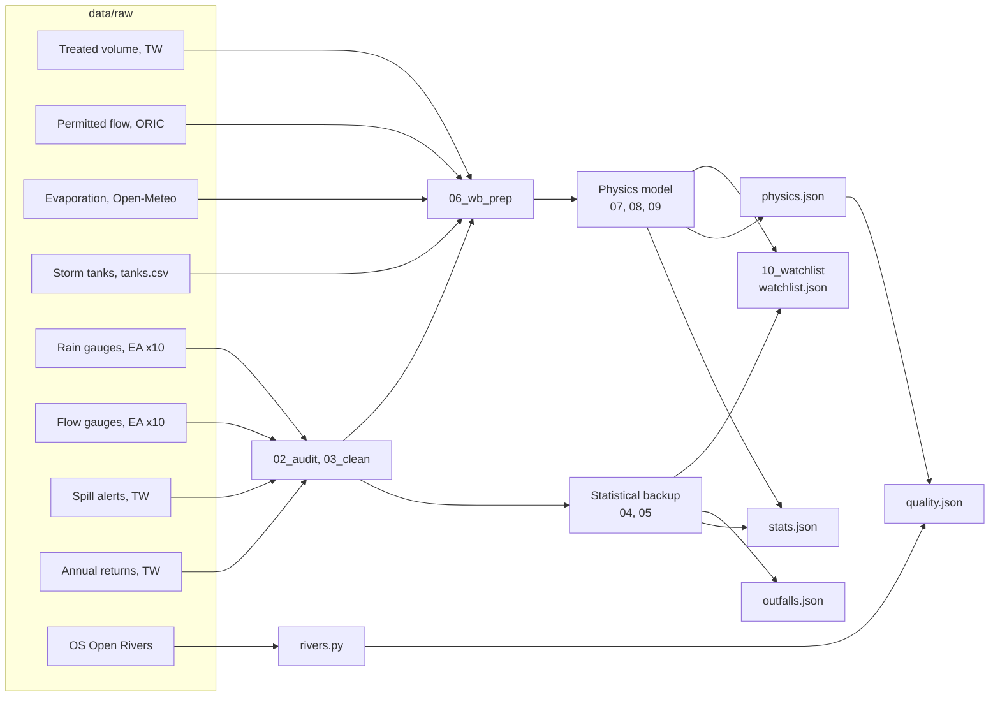

# Data: what we use, where it comes from, and what each part of Spillcast reads

A plain-language guide to every dataset behind Spillcast; the script that produces each file is named next to it. The raw and cleaned data are **not in git** (`data/` is git-ignored, ~500 MB): the [README](../README.md#rebuild) shows how to get it back. The website's own data (`web/data/`) **is** in git.

## The short version

Everything comes from free, public sources:

1. **When overflows spilled:** Thames Water's spill monitors (start and stop times), checked against Thames Water's official yearly totals.
2. **The weather and the rivers:** Environment Agency rain gauges (every 15 minutes) and river-flow gauges (daily), plus daily evaporation from Open-Meteo.
3. **What each sewage works treated and is permitted to treat:** Thames Water's daily treated volumes, and the Oxford Rivers Improvement Campaign's sheet of each works' permitted flow (FFT).
4. **The rivers:** OS Open Rivers for the river network.

We checked all of it before modelling. Most of it is good, but we found and fixed real problems: some spill monitors' records disagree badly with Thames Water's own totals, some rain gauges were blocked for months, river-flow values were dated so that the model could peek hours ahead, and some works' treated-flow records have meter faults. The cleaned versions live in `data/interim/`.

Rain and river flow are cleaned once (`03_clean.py`) and used by both models. Spill records are scored against by both, but only the statistical backup is fitted to them.

## Which data feeds which part

| Dataset | Physics model (main) | Statistical backup | Watchlist | River map |
| --- | --- | --- | --- | --- |
| Treated volume (1.6) | what it is fitted to; capacity; error size | | treated flow on all-day spill days (Test A) | – |
| Permitted flow, ORIC (1.7) | starting value and bounds for foul flow; independent checks | | the 80% screen (Test A) | |
| Storm-tank volumes (1.10) | tank size at 5 works (2 h at capacity elsewhere) | | | starting tank in the What-if card |
| Evaporation (1.8) | soil-moisture store | | | What-if rerun |
| Rain gauges (1.4) | yes, two nearest gauges per works | yes, same two gauges | | What-if rerun |
| River flow (1.5) | Farmoor: river-driven infiltration (18 of 52 works) | Farmoor: how wet the catchment is | | dilution in the river |
| Spill alerts (1.1) | scoring only, never fitted | labels it learns from | spill hours per day; unexplained days (Test B) | which works spilled on past days |
| Overflow list (1.2) | | locations | | discharge points |
| Annual returns (1.3) | | data check; groundwater check | asset type, Thames Water's stated reason, investigation status | names, rivers |
| OS Open Rivers (1.9) | | | | river network, travel time, E. coli and ammonia |

---

## Part 1 · Raw data

Everything here is exactly as downloaded, in `data/raw/`.

### 1.1 Spill alerts: *when overflows spilled*

| | |
| --- | --- |
| **What it is** | Every alert from Thames Water's spill monitors (EDM, "event duration monitoring"): a **Start** when an overflow begins discharging, a **Stop** when it ends, and **Offline start / stop** when the monitor isn't working |
| **Source** | Thames Water open data API, `api.thameswater.co.uk/opendata/v2/discharge/alerts` (no key needed) |
| **Files** | `thames_alerts.csv` (all alerts) → paired by `scripts/fetch.py events` into `events.csv` (one row per spill) and `offline.csv` (one row per monitor outage) |
| **Coverage** | 1 Apr 2022 → 24 Oct 2026; 544 overflows across the Thames Water region |
| **Size** | 153,783 alerts → 74,435 spills (30 still running at download) and 2,438 outages |
| **Columns** | site name, permit number (the ID that links to other datasets), grid reference, receiving river, alert type, date-time |
| **Watch out for** | Times are UK local clock time with no time zone (they jump at the clock changes). Monitors can be triggered by things other than sewage (Thames Water: "even the movement of a weed"), so a "spill" is a monitor activation, not a confirmed discharge |

### 1.2 Overflow list: *where the overflows are*

| | |
| --- | --- |
| **What it is** | A snapshot of all 573 Thames Water spill monitors: name, permit number, location, receiving river, current status |
| **Source / file** | Thames Water API `/discharge/status` → `thames_status.csv` |
| **Used for** | Locations. We cover the **61 overflows within 25 km of central Oxford** (`sites61.csv`): 54 at sewage works, 4 at pumping stations, 2 in the sewer network, 1 unknown |

### 1.3 Official annual spill returns: *the independent check, and Thames Water's own explanations*

| | |
| --- | --- |
| **What it is** | Thames Water's official yearly return to the regulator, one row per overflow: total spill hours and count, how much of the year the monitor worked, overflow type (storm tank at a works, inlet overflow, pumping station, network), and for high-spilling sites the stated reason, investigation activity and improvement activity |
| **Source** | Thames Water [storm discharge and flow data](https://www.thameswater.co.uk/about-us/performance/river-health/storm-discharge-and-flow-data) page (Excel), downloaded by hand |
| **Files** | `annual_returns/tw_edm_2023.xlsx`, `tw_edm_2024.xlsx`, `tw_edm_2025.xlsx` (Thames Water-only sheets, headers on row 6) |
| **Used for** | Checking our spill hours site by site (2024, 2025); testing whether the model's "groundwater" signal matches Thames Water's "GW inundation" tag; site names, receiving rivers and overflow types on the map; the watchlist's "Thames Water's stated reason and investigation status" (2025) |

### 1.4 Rain: *how much rain fell, every 15 minutes*

| | |
| --- | --- |
| **What it is** | Rainfall every 15 minutes at 10 Environment Agency gauges around Oxford |
| **Source** | EA Hydrology API, fetched by `scripts/fetch.py gauges` |
| **Files** | `gauges/rain_<gauge ID>.csv`, about 168,700 readings each, 2 Jan 2022 → 24 Oct 2026 |
| **Gauges** | Osney Lock (256230TP), Eynsham (254336TP), Wheatley (263541TP), Abingdon (261021TP), Bicester (259110TP), Benson (264254TP), Worsham (253861TP), Chipping Norton (254829TP), Aylesbury (261923TP), Stokenchurch (274178TP) |
| **How it's used** | Each overflow gets an inverse-distance mix of its two nearest gauges (`site_inputs.csv`). Both models and the river map's What-if mode use this same mix |
| **Watch out for** | Each reading has a quality flag. Some gauges flag a lot of readings **"Suspect"**: Worsham 57%, Osney 43%. At some gauges Suspect readings are far too low (blocked gauge) |

### 1.5 River flow: *how full the rivers are, daily*

| | |
| --- | --- |
| **What it is** | Daily average river flow (m³ per second) at 10 EA gauges |
| **Source** | EA Hydrology API, fetched by `scripts/fetch.py gauges` |
| **Files** | `gauges/flow_<gauge ID>.csv`, about 1,750 days each, 2 Jan 2022 → 23 Oct 2026 |
| **Gauges** | **Thames at Farmoor (1100TH): the one both models use**, as a measure of how wet the catchment is. The other nine (Cherwell at Oxford 1490TH, Ray/Cherwell at Islip 1489TH, Evenlode at Cassington 1290TH, Thame at Wheatley 1980TH, Ock at Abingdon 1790TH, Thames at Sutton Courtenay 1800TH, Glyme at Woodstock 1289TH, Ewelme Brook 1995TH, Windrush at Newbridge 1090_w1TH, closed Oct 2023) give the dilution on gauged rivers in the water-quality model, and were offered to the gradient-boosting comparison |
| **Watch out for** | A "daily" value dated 2 Jan covers **09:00 on 2 Jan to 09:00 on 3 Jan** (the EA "water day"). Quality varies: Farmoor 95% "Good"; Glyme at Woodstock 54% "Suspect" |

### 1.6 Treated volume: *how much sewage each works treated, daily*

| | |
| --- | --- |
| **What it is** | Total volume treated per day (m³) at every Thames Water sewage works treating over 50 m³/day ("TDV", total daily volume). This is what was **treated**, measured at the outlet, not what spilled |
| **Source** | Thames Water storm discharge and flow data page (Excel, one file per year), downloaded by hand |
| **Files** | `tdv/tdv2019.xlsx` … `tdv2025.xlsx` (277–299 works per year; 2026 not yet published) |
| **Used for** | The water balance is fitted to it (2019–2025). The watchlist compares it with each works' permitted flow on all-day spill days (Apr 2022 → Dec 2025). |
| **Watch out for** | Column names change between years (e.g. `ABINGDON STW2` vs `ABINGDON STW (2)`; Abingdon has two outlets, which we sum). "Suspect" values are marked only by cell colour. Some meters log runs of zeros or impossible spikes (Carterton: 28 million m³ in a day) |

### 1.7 Permitted flow (FFT) and capacity: *how much each works should treat*

| | |
| --- | --- |
| **What it is** | For 351 Thames Water works, sheet "Required capacities": permitted flow to full treatment (FFT, litres per second), maximum infiltration allowance, flow per person, population equivalent, trade flow, and the FFT the works should have under the regulator's formula |
| **Source** | Oxford Rivers Improvement Campaign / UKCEH, from a Thames Water information request (June 2024): [ORIC capacity sheet](https://oxfordrivers.ceh.ac.uk/data/ORIC_Thames_Sewage_Works_Capacity_Final.xlsx) |
| **File** | `oric_fft.xlsx` |
| **Used for** | The watchlist's permit screen (treated flow under 80% of FFT on all-day spill days); FFT and population in each works' evidence file; the water balance's foul-flow and infiltration checks; |
| **Watch out for** | Two works have no published FFT (Tackley, Worminghall). The water balance doesn't use FFT as its capacity: it uses the 95th percentile of each works' own treated flow, because published FFT is off by 13% typically. |

### 1.8 Evaporation: *how fast the ground dries out*

| | |
| --- | --- |
| **What it is** | Daily FAO reference evapotranspiration (and rain) at one point in central Oxford (51.75 N, 1.26 W), 1 Jan 2022 → 22 Oct 2026 |
| **Source** | Open-Meteo historical weather API (ERA5 reanalysis), fetched automatically by `06_wb_prep.py` if the file is missing |
| **File** | `openmeteo/et0_oxford_daily.csv` |
| **Used for** | The water balance's soil-moisture store, which decides when ground is saturated and starts running off into the sewers. Only the evaporation column is used; rain comes from the EA gauges |

### 1.8b Weather forecast: *the next 7 days*

| | |
| --- | --- |
| **What it is** | Hourly precipitation from all 51 members of the ECMWF IFS 0.25° ensemble at each of the 10 EA gauge locations; daily FAO reference evaporation for Oxford |
| **Source** | Open-Meteo [ensemble API](https://open-meteo.com/en/docs/ensemble-api) and [forecast API](https://open-meteo.com/en/docs), fetched live by `scripts/model/09_forecast.py` |
| **Used for** | The physics model's 7-day forecast ([model.md](model.md#forecast)); not stored in `data/raw` |

### 1.9 River network: *where the water goes*

| Data | Source | File | Used for |
| --- | --- | --- | --- |
| **OS Open Rivers** | Ordnance Survey, GeoPackage for Great Britain | `os_open_rivers/oprvrs_gb.gpkg` (113 MB) | The river network: each works is snapped to its river and traced downstream for the water-quality model |

### 1.10 Storm-tank volumes: *how much each works can hold back*

The physics model needs each works' storm-tank volume. No dataset gives it in bulk, so `scripts/model/tanks.csv` holds every volume a source states, with the source and a quote; elsewhere the model uses the design rule of 2 hours at capacity.

| Works | Tank (m³) | Model's 2 h rule (m³) | Source |
| --- | --- | --- | --- |
| Oxford | 6,831 (18,167 tendered) | — | [Find a Tender notice 2024/S 000-031739](https://www.find-tender.service.gov.uk/Notice/031739-2024), Thames Water, Oct 2024 |
| Witney | 2,201 actual (permit 1,728) | 2,067 | [Hammond et al. 2021](https://doi.org/10.1038/s41545-021-00108-3), Table 1, "WWTP2" |
| Church Hanborough | 359 actual (permit 364) | 422 | Hammond et al. 2021, Table 1, "WWTP1" |
| Carterton | 900 | 828 | [Written evidence WQR0020](https://committees.parliament.uk/writtenevidence/22257/html/) to the Environmental Audit Committee, Feb 2021 |
| Bampton | 173 | 160 | Same, Table 3 |

- Hammond et al. keep the works anonymous; WWTP1/2 are identified by their stated permitted flows (50.52 and 240 L/s), which match Church Hanborough and Witney exactly.
- The two Witney sources disagree: WQR0020 gives 1,728 m³ as "actual", which equals 2 h at 240 L/s, so it is probably the permitted figure. Witney's 2026 upgrade may have changed it.
- Where checked, the 2-hour rule is within 6–18% of the real tank.
- **Not usable:** the EA's "Consented Discharges to Controlled Waters with Conditions" has no tank field. The route to the other 48 works is an Environmental Information Regulations request to Thames Water, which is how both sources above got theirs.

### 1.11 Downloaded but not used

| Data | File(s) | Why it's here |
| --- | --- | --- |
| ERA5-Land soil moisture and ERA5 rain (Open-Meteo, 26 grid cells) | `openmeteo/era5land_*.csv` | Tested as alternatives to the gauges; both did worse, so dropped |
| Early single-gauge downloads (Osney daily rain, Oxford and Horspath boreholes, Cherwell / Kings Mill / Osney / Sandford levels) | `hydro_*.csv` | First exploration; the borehole turned out to be the weakest signal |
| Oxford-only alerts | `thames_alerts_oxford.csv` | First exploration; superseded by the full download |
| EA LIDAR terrain and terrain tiles | `oxford_dtm_*.tif`, `terrarium/` | Built an earlier 3D map, since removed |

---

## Part 2 · What the checks found

### 2.1 Spills, rain and river flow (`scripts/model/02_audit.py`)

| Data | What we found | What we did |
| --- | --- | --- |
| **Spill alerts vs official totals** | For a typical site our hours match Thames Water's official total to within 0.1% (75% of sites within ±5% in 2024, 87% in 2025). But **13 site-years are badly wrong**: four sites (Didcot, Charlton-on-Otmoor, Middleton Stoney, Weston-on-the-Green pumping station) have official hours but **no alerts at all** in the feed; Chalgrove's feed has 7% of its official hours; Islip's has double | Those 13 site-years are excluded |
| **Spill alerts: chatter** | 16% of spills last under 15 minutes; 42% of gaps between spills are under an hour | Doesn't affect hourly data; merged for any count of "events" |
| **Spill alerts: very long spills** | 155 spills over a week, 14 over a month (longest: South Leigh, 54 days in 2026) | Kept: groundwater-fed works genuinely spill for weeks |
| **Spill alerts: pairing** | 22 odd sequences in 34,000 alerts for our 61 sites (e.g. two Starts in a row) | Too few to matter; noted |
| **Rain** | Suspect readings at some gauges far too low; Benson read 557 mm in 2024 when its neighbours read ~950 mm; missing rain was being treated as "no rain" | Suspect → missing; days far from the neighbouring gauges → missing; gaps filled from the other gauges |
| **River flow** | Each daily value covers 09:00 to 09:00 the next day, so using "yesterday's" value let the model see up to 9 hours into the future | Each value only used 12 hours after its 24-hour window ends |

### 2.2 Treated flow (`scripts/model/06_wb_prep.py`)

Each spill-monitored works is matched to its treated-volume column and its ORIC row by name (with a few hand fixes, e.g. Middleton Stoney is "MIDDLETON STONY" in the TDV files). Zeros and days above 10× the works' median are treated as missing. Then each works' flow record is checked against its spill record. Spill records are used here only to judge the data, never to fit the water balance.

| Verdict | Works | Meaning |
| --- | --- | --- |
| Good | 40 | Passes every check |
| Groundwater-led | 3 (Cholsey, Dorchester, South Moreton) | Flow follows groundwater, not rain |
| No published capacity | 2 (Tackley, Worminghall) | No FFT; capacity taken from the flow itself |
| **Check** | 7 (Appleton, Bletchingdon, Chadlington, Drayton, Middle Barton, Shabbington, Watlington) | Over 30% of days spilling 12+ hours show treated flow under 80% of capacity: a meter problem or a works not treating what it should. **Four of these are strong watchlist leads**, so the data question and the lead are the same question |
| Dropped | 1 (Middleton Stoney) | Flow data for only 26% of days |
| No treated-flow data | 8 sites | Pumping stations (Bucknell, Littlemore Low Level, Manor Farm), network overflows (The Willows, West Way, Weston-on-the-Green network overflow), Tubney, and Stanford-in-the-Vale (no unambiguous treated-volume column). Not in the water balance or the watchlist |

Oxford's treated-volume column is complete (< 1% missing every year); its peak exceeds the published FFT in some years (up to 1.23×), one reason published FFT is treated as approximate.

---

## Part 3 · Clean data and model outputs

All in `data/interim/` (not in git).

### 3.1 Clean data layer (`scripts/model/03_clean.py`): **what the models read**

| File | What's in it | How it was made | Size |
| --- | --- | --- | --- |
| `sites61.csv` | The 61 overflows: permit number, name, grid location, latitude/longitude | `01_sites.py`, from the alert locations | 61 rows |
| `labels_clean.pkl` | For each overflow, hour by hour (1 Apr 2022 → 24 Oct 2026, UTC): **what fraction of the hour it was spilling** (0 to 1) and **whether that hour is trustworthy** (monitor working, site-year not broken) | From `events.csv` and `offline.csv`, using exact minutes | 61 sites × 39,984 hours |
| `inputs_clean.pkl` | Hour by hour: rain at each of the 10 gauges (checked and gap-filled) and the log of river flow at each flow gauge (as known at that hour) | From the gauge files | 39,984 hours × 20 columns |
| `site_inputs.csv` | Which two rain gauges each overflow uses, and how far away they are | Nearest two gauges | 61 rows |
| `site_quality.csv` | Per overflow: which years were excluded, what share of time is trustworthy, total spill hours | From the audit | 61 rows |
| `audit_reconciliation.csv` | Per overflow and year: official spill hours vs ours, and the ratio | `02_audit.py` | 114 rows |
| `st_rainfall.json`, `st_waterFlow.json` | EA station lists (gauge locations) | `01_sites.py` | — |

**Before and after cleaning, in numbers**

| | Before | After |
| --- | --- | --- |
| Total spill-hours, 61 sites | 187,653 (each spill rounded out to whole hours) | **173,940** (exact minutes) |
| Oxford STW spill-hours, 2024 / 2025 | — | **3,200 / 590**, vs Thames Water's official 3,198 / 590.5 |
| Site-years we trust | all | all except 13 |
| Rain gauge-days removed as faulty | 0 | 47 (plus all Suspect readings) |
| Rain hours filled from neighbouring gauges | 0 (missing read as zero) | from 0.2% (Wheatley) to 55% (Worsham) of hours; Osney 41% |
| Hours where flow "knew the future" | up to 9 every morning | none |

### 3.2 Water-balance inputs (`06_wb_prep.py`)

| File | What's in it | Size |
| --- | --- | --- |
| `wb_works.csv` | One row per works: FFT, maximum infiltration, foul flow, population, required FFT (all from ORIC), treated-flow coverage, and the audit verdict (2.2) | 53 works |
| `wb_tdv.pkl` | Daily treated volume (m³/day), one column per works, faults removed | 1 Jan 2019 → 31 Dec 2025 × 53 |

### 3.3 Model outputs

| File | What's in it | Made by |
| --- | --- | --- |
| `eval_predictions.pkl` | Every test day for every overflow: what happened, and what each model predicted (Explain, Forecast, persistence, gradient boosting), for both folds | `04_stat_evaluate.py` |
| `site_cards.csv` | Per overflow, in plain units: the river flow that triggers a spill with no rain, the rain that triggers it on a typical winter day, how long rain keeps counting, and the groundwater signature | `05_site_cards.py` |
| `wb_params.csv` | Water balance fitted per works and fold, in physical units: foul flow, peak infiltration, hard and saturated runoff areas, capacity, storm-tank volume, spill start; ORIC's figures alongside for comparison | `07_wb_fit.py` |
| `wb_predictions.pkl`, `wb_flow.pkl` | Water balance per day: chance of a spill, spill-hours and volume; simulated vs measured treated flow | `07_wb_fit.py` |
| `wb_eval_rows.pkl` | Physics and statistical model side by side on the same held-out days (the watchlist's "unexplained spill" test reads this) | `08_wb_evaluate.py` |
| `wb_*_abl_*` | Ablation runs (capacity quantile, wet-ground runoff, tank size, pump-back) | `07_wb_fit.py` with `WB_*` switches |
| `wb_forecast.pkl`, `wb_forecast_drivers.json` | 7-day forecast per works and day; forecast rain, evaporation and start-of-day states | `09_forecast.py` |
| `watchlist.json` | The regulator watchlist per works: level, findings, dates, Thames Water's stated reason and investigation status, daily treated flow and spill-hours | `10_watchlist.py` |
| `web_links.pkl` | OS Open Rivers links in the map box | `scripts/web/rivers.py` |

Other files in `data/interim/` (`inputs_hourly.pkl`, `labels_hourly*.pkl`, `exp_*.pkl`, `oxford_*.csv`, `multisite.csv`, `out_*.pkl`, `web_elev.npy`, `web_grid.json`) come from removed scripts and can be deleted.

### 3.4 Website data (`web/data/`, **in git**)

| File | What's in it | Made by |
| --- | --- | --- |
| `outfalls.json` | The 61 overflows: name, type, receiving river, location; what each monitor recorded each day of the test year (1 Oct 2025 → 24 Oct 2026) | `scripts/web/outfalls.py` |
| `physics.json` | Physics model per works: daily chance, spill-hours and volume (test year + 7-day forecast); fitted parameters; start-of-day states; hourly rain, evaporation and river flow, so the page can rerun a day with different rain, tank or capacity | `physics.py` |
| `quality.json` | 100 m river segments downstream of each works, river flow per day, spill days and rates, and the water-quality parameters | `quality.py` |
| `stats.json` | Scores of both models on the same held-out days; calibration | `stats.py` |

**One end date:** `DATA_END` in `scripts/model/common.py` (now 2026-10-24 23:00 UTC) sets the last hour of observed data for `03_clean.py`, the fold B test window and the evaporation download in `06_wb_prep.py`. Move it and rerun to extend everything; the forecast (`09_forecast.py`) starts the hour after it.

**Downloads by hand** (direct file links work with a browser user agent): Thames Water [storm discharge and flow data](https://www.thameswater.co.uk/about-us/performance/river-health/storm-discharge-and-flow-data) (treated volumes → `data/raw/tdv/tdvYEAR.xlsx`, annual returns → `data/raw/annual_returns/tw_edm_YEAR.xlsx`), the [ORIC capacity sheet](https://oxfordrivers.ceh.ac.uk/data/ORIC_Thames_Sewage_Works_Capacity_Final.xlsx) (→ `data/raw/oric_fft.xlsx`) and [OS Open Rivers](https://osdatahub.os.uk/downloads/open/OpenRivers) (→ `data/raw/os_open_rivers/oprvrs_gb.gpkg`).

---

## Glossary

| Term | Meaning |
| --- | --- |
| **Storm overflow** | A relief point where a sewer or sewage works discharges diluted sewage into a river when it is overloaded |
| **STW / WwTW** | Sewage (wastewater) treatment works |
| **CSO** | Combined sewer overflow: an overflow out in the sewer network rather than at a works |
| **EDM** | Event duration monitoring: the sensor that logs when an overflow starts and stops |
| **Permit number** | The Environment Agency's ID for each discharge (e.g. Oxford STW = TEMP.2827); the key that joins datasets |
| **TDV** | Total daily volume treated at a works (m³/day), measured at the outlet |
| **FFT** | Flow to full treatment: the flow a works is permitted to and must treat before it may spill. Compliance: 95% of readings above 92% of FFT while spilling |
| **MON3 / MON4** | The operator's overflow monitor and its 15-minute FFT flow monitor; the records that settle a watchlist lead |
| **Population equivalent (PE)** | Size of a works in "people's worth" of sewage |
| **Water day** | The EA's day for river flow: 09:00 to 09:00 |
| **"Suspect" flag** | The EA's marker that a reading may be wrong |
| **Site-year** | One overflow's record for one calendar year |
| **Fold A / B** | The two held-out test periods: A = Oct 2024 → Sep 2025, B = Oct 2025 → 24 Oct 2026 |
